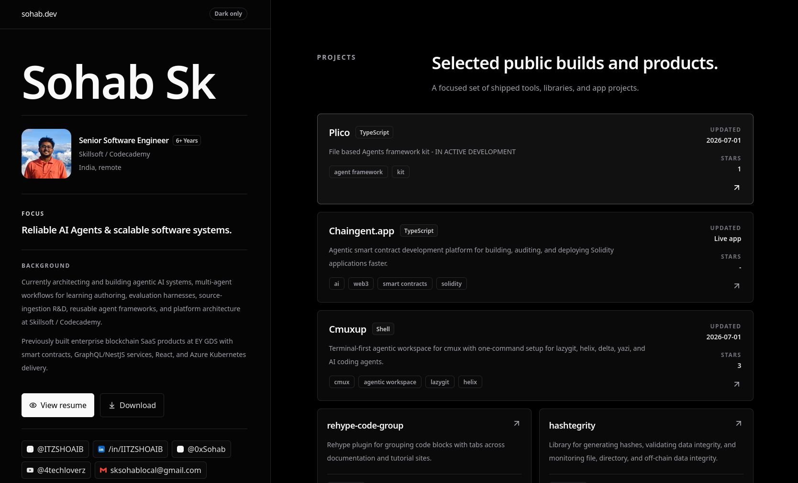

<div align="center">



### A fast, dark, SEO-friendly personal portfolio for AI agents, scalable systems, and selected engineering work.

[](https://svelte.dev/docs/kit)
[](https://www.typescriptlang.org/)
[](https://tailwindcss.com/)
[](https://pages.cloudflare.com/)

[Live Site](https://sohab.dev) · [Deployment Notes](./DEPLOYMENT.md) · [Resume](./content/public/resume.pdf)

</div>

---

## Overview

This repository powers [sohab.dev](https://sohab.dev), the personal portfolio of **Sohab Sk**, Senior Software Engineer at **Skillsoft / Codecademy**.

The site highlights work across agentic AI systems, multi-agent learning-authoring workflows, reusable agent frameworks, full-stack web platforms, blockchain SaaS products, and selected open-source projects.

## What It Includes

- **Modern SvelteKit app** using Svelte 5, Vite, TypeScript, and Tailwind CSS.
- **Content-driven portfolio data** for profile, projects, experience, skills, and an optional blog.
- **SEO and social sharing metadata** with Open Graph, Twitter card tags, canonical URLs, and JSON-LD structured data.
- **Cloudflare Pages deployment path** using the SvelteKit Cloudflare adapter.
- **Generated robots and sitemap routes** for crawler-friendly indexing.
- **CI verification** that runs type checks and production builds on pushes and pull requests.

## Tech Stack

| Area | Tools |
| --- | --- |
| Framework | SvelteKit, Svelte 5 |
| Language | TypeScript |
| Styling | Tailwind CSS 4 |
| Build Tool | Vite |
| Icons | Lucide Svelte, Simple Icons |
| Deployment | Cloudflare Pages |
| Package Manager | pnpm 11.9.0 |
| Runtime | Node.js 24+ |

## Project Structure

```text
.
├── .github/workflows/ci.yml       # GitHub Actions check and build workflow
├── DEPLOYMENT.md                  # Cloudflare Pages deployment instructions
├── content/                       # Everything personal; the code reads only from here
│   ├── site.ts                    # Site metadata and feature flags
│   ├── profile.ts                 # Name, role, links
│   ├── selected-work.ts           # Selected work cards
│   ├── github-projects.ts         # Project cards
│   ├── experience.ts              # Experience timeline
│   ├── skills.ts                  # Skill groups
│   ├── copy.ts                    # Section headlines, blog blurb, Ask AI prompts
│   ├── figures/                   # Post figures: components plus their captions
│   ├── posts/                     # Blog posts, one Markdown file each
│   ├── projects/                  # Project pages linked from the cards
│   └── public/                    # Served from the site root: images, resume, icons
├── scripts/                       # check-content, new:post, new:project, make-template and their tests
├── template/                      # Starter content and overlay files used by make-template
├── src/
│   ├── lib/
│   │   ├── components/            # Portfolio sections and UI pieces
│   │   ├── content/               # Markdown pipeline, post queries, feeds
│   │   ├── icons/                 # Icon helpers
│   │   ├── types/                 # Shared portfolio types
│   │   └── utils/                 # Formatting utilities
│   └── routes/                    # SvelteKit pages, sitemap, and robots routes
├── package.json
├── svelte.config.js
├── tsconfig.json
└── vite.config.ts
```

## Getting Started

### Prerequisites

- Node.js `>=24`
- pnpm `11.9.0`

### Install

```bash
pnpm install
```

### Run Locally

```bash
pnpm dev
```

The dev server binds to `0.0.0.0`, which is useful for local network previews and containerized environments.

### Check And Build

```bash
pnpm verify
```

This runs:

```bash
pnpm check
pnpm build
```

### Preview Production Build

```bash
pnpm preview
```

## Available Scripts

| Command | Description |
| --- | --- |
| `pnpm dev` | Start the local Vite development server. |
| `pnpm check` | Sync SvelteKit types and run `svelte-check`. |
| `pnpm build` | Create a production build. |
| `pnpm preview` | Preview the production build locally. |
| `pnpm verify` | Run checks and build together. |

## Customizing Content

Most portfolio content is centralized in a small set of files:

| File | Purpose |
| --- | --- |
| `content/site.ts` | Site URL, title, description, Open Graph image metadata, keywords, and feature flags (`blog`, `askAi`, `mcp`, `openToWork`). |
| `content/profile.ts` | Name, role, location, email, social links, and career start date. |
| `content/selected-work.ts`, `content/github-projects.ts` | The selected work and project cards. |
| `content/experience.ts`, `content/skills.ts` | Experience timeline and skill groups. |
| `content/copy.ts` | Section headlines and descriptions, the `/blog` blurb, and the prompts in the Ask AI dialog. |
| `content/figures/` | Interactive figures for posts: each component, its caption and its text description. |
| `content/posts/*.md` | Blog posts, one markdown file each. |
| `content/projects/*.md` | Project pages linked from the project cards. |
| `content/public/` | Files served from the site root: `resume.pdf`, `images/` (profile photo, social preview, covers), icons, and the web manifest. |

Code outside `content/` holds no personal data. `$content` is an alias for the folder.

### Content commands

All three are noninteractive, so scripts and coding agents can run them.

| Command | What it does |
| --- | --- |
| `pnpm check-content` | Validates `content/`: required fields, image files that exist, full URLs, posts that reference real projects, cards that link to real pages. Exits `1` with one line per problem, each saying what to fix. `--json` prints the problems as data. In a generated template it also reports starter values and files that are unchanged; `--allow-placeholders` accepts the placeholder photo, social image and resume. |
| `pnpm new:post "Title" [--description ...] [--tags a,b] [--projects Name] [--cover /images/x.jpg] [--published 2026-01-31] [--publish]` | Creates `content/posts/<slug>.md`. Without `--publish` it is a hidden draft; `--publish` needs `--description`. Never overwrites. |
| `pnpm new:project "Name" --repo <url> --description "..." [--updated 2026-01-31]` | Creates `content/projects/<slug>.md`, the page a project card links to. Never overwrites. |
| `pnpm test` | Runs the script tests (`node --test`, no extra dependencies). |

`pnpm verify` runs type checks, the script tests, `check-content` and the build. These scripts need Node 22.18 or newer (they run TypeScript directly).

## Blog

Posts are markdown files in `content/posts/` with frontmatter:

```md
---
title: Post title
description: One-sentence summary used for cards, SEO, and feeds.
published: 2026-11-10   # or 2026-11-10T14:30 to order posts published the same day
updated: 2026-11-12   # optional
tags: [agents, sveltekit]
projects: [Plico]     # optional, "Where I use this" cards, by name from githubProjects
cover: /images/blog/my-post.jpg  # optional, a JPEG under content/public/: list thumbnail and social image
aliases: [old-slug]   # optional, former slugs; /blog/old-slug redirects to this post
draft: true           # optional, hides the post everywhere
---
```

Each published post gets a page at `/blog/<slug>` with a table of contents, Shiki syntax highlighting, `rehype-code-group` tabs, related posts, an author note and a generated social image at `/blog/<slug>/og.png`. The blog also serves `/blog`, `/tags/<tag>`, `/rss.xml` (full content), `/feed.json`, sitemap entries and `llms.txt` links. With no published posts, `/blog` is `noindex` and the home section stays hidden. Set `features.blog` to `false` in `content/site.ts` to switch it all off. `features.askAi` hides the Ask AI button and dialog, and `features.mcp` removes the `/mcp` endpoint and its mention in `llms.txt`.

The URL comes from the file name, so renaming a post would break its old link and lose its search ranking. Rename it and list the old name under `aliases`: the build writes a `_redirects` file (`src/routes/_redirects/+server.ts`) that Cloudflare Pages reads, giving `/blog/old-slug` and `/blog/old-slug.md` a permanent 301 to the new URL. The build fails if an alias matches an existing post or is claimed twice. The redirects only run on Cloudflare Pages, not in `pnpm preview`.

Posts are listed newest first; two posts on the same day are ordered by the time in `published` (date-only counts as midnight), then by title. The `/blog` page opens with the latest post as a featured card, then the rest grouped by year. With JavaScript it adds a search box and topic and project filter chips (the state lives in `?q=`, `?tag=` and `?project=`, so a filtered list can be linked), and without it the plain topic links and every post still work. It also links the RSS and JSON feeds, with a button that copies the RSS URL to paste into a feed reader.

Posts are plain markdown with a few extensions. The source stays readable as markdown, so the `.md` copy, feeds and `llms-full.txt` keep working:

````md
> [!TIP] Optional title
> Callouts use GitHub alert syntax: NOTE, TIP, IMPORTANT, WARNING, CAUTION, TLDR.

::figure harness-anatomy

```prompt title="Try it with your agent"
A prompt readers can copy or open in Claude or ChatGPT.
```


<video src="/videos/demo.mp4" controls muted playsinline></video>
````

A `::figure <id>` line renders a motion graphic: a Svelte component that plays itself while it is on screen, so readers watch rather than click (`autoplay` in `src/lib/utils/autoplay.ts`). With reduced motion, it shows a static version instead. Register its component, caption and text description in `content/figures/index.ts`; an unknown id fails the build. Feeds and the `.md` copy show the caption, description and a link to the figure instead.

A `cover` is a finished 1200x630 JPEG under `content/public/`, with the title already on it (large enough to read as a small thumbnail). It is the thumbnail on the `/blog` list card, beside the text on wide screens and above it on phones, and it is served as the post's social image (`/blog/<slug>/og.png`) as is. It is not shown on the post page. A post without one gets the plain text social card.

For readers who learn with AI:

- **Select to ask.** Selecting text in a post shows a small toolbar that opens Claude or ChatGPT with the passage, the post title and its URL, or copies that prompt.
- **Post actions.** Under the title, a "Read with" row opens the post in Claude or ChatGPT, or copies it as markdown.
- **Markdown for agents.** `/blog/<slug>.md` serves each post as plain markdown. `llms.txt` links to it, `llms-full.txt` includes every post, and the `/mcp` server adds `list_blog_posts` and `read_blog_post`, with post paragraphs in `search_portfolio` results.

## Deployment

The site is configured for **Cloudflare Pages** through Git integration.

Recommended Cloudflare build settings:

| Setting | Value |
| --- | --- |
| Framework preset | `SvelteKit` |
| Build command | `pnpm verify` |
| Build output directory | `.svelte-kit/cloudflare` |
| Node version | `24` |
| pnpm version | `11.9.0` |

See [DEPLOYMENT.md](./DEPLOYMENT.md) for the full deployment checklist, including the Cloudflare `nodejs_als` compatibility flag.

## Quality Gates

- Type checking with `svelte-check`.
- Production build validation through `pnpm verify`.
- GitHub Actions workflow on `main`, pull requests, and manual dispatch.
- Cloudflare Pages build also runs `pnpm verify` so invalid builds are not published.

## License

This is a personal portfolio project. Unless a license is added later, all rights are reserved.

---

<div align="center">

Built by [Sohab Sk](https://sohab.dev) · [GitHub](https://github.com/ITZSHOAIB) · [LinkedIn](https://www.linkedin.com/in/IITZSHOAIB)

</div>

## Template

This repo is the source of the `agent-ready-portfolio` template: the same app, with a placeholder person instead of the owner's content. `pnpm make-template --out <dir>` writes it for review; nothing is pushed.

```sh
pnpm make-template --out ../agent-ready-portfolio          # new folder (must be empty or missing)
pnpm make-template --out ../agent-ready-portfolio --force  # replace a previous output, keeping .git
```

- App code is copied from this repo's tracked and unignored files. `content/`, `template/`, the generator and this README are left out.
- `template/starter/content/` is the placeholder content (Alex Rivera, a "Hello world" post that documents authoring, one sample project, one example figure). `template/overlay/` holds files that replace or add root files: the template's `README.md`, `AGENTS.md` (setup runbook for coding agents), `CLAUDE.md`, `SETUP.md`, `DEPLOYMENT.md` and the MIT `LICENSE` (code only; the original site's posts, photos, resume and images are excluded). A test checks that the runbook names only commands the template has.
- Placeholder images, icons and the resume PDF are generated as shapes (no fonts, no binaries in git).
- `content/.starter.json` lists the starter values and files. `pnpm check-content` reports any that are still unchanged, so an agent knows setup is not finished (`--allow-placeholders` waives only the photo, social image and resume). `location`, and a project card's `updated` and `stars`, are optional and hidden when left out. `pnpm verify` runs `check-content --ignore-starter`, so a fresh template still builds.
- Personal data must stay in `content/`. A test generates the template and fails if the owner's names or topics appear anywhere in it.
