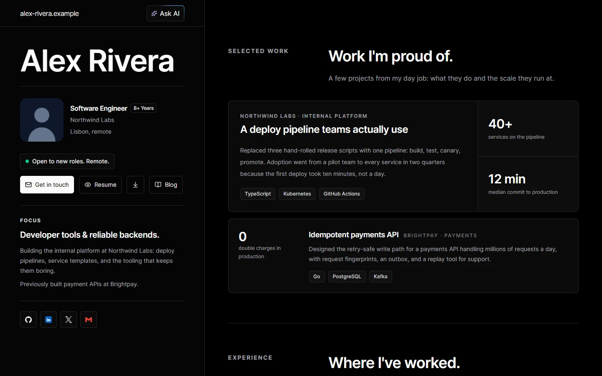
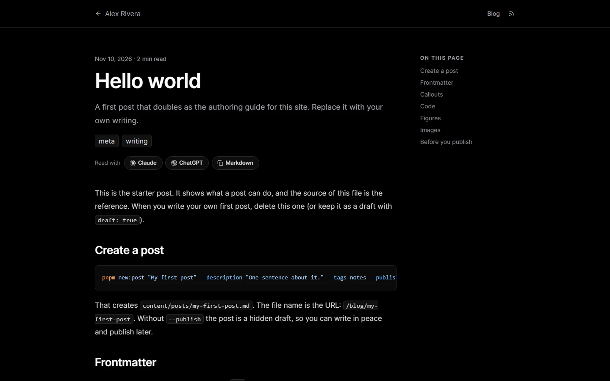
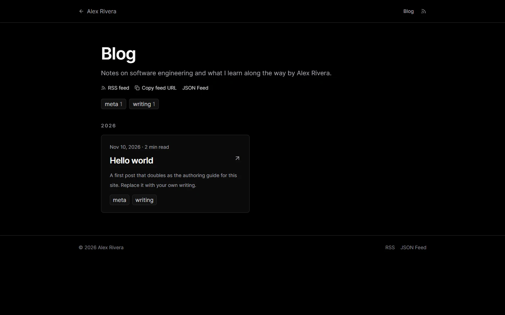
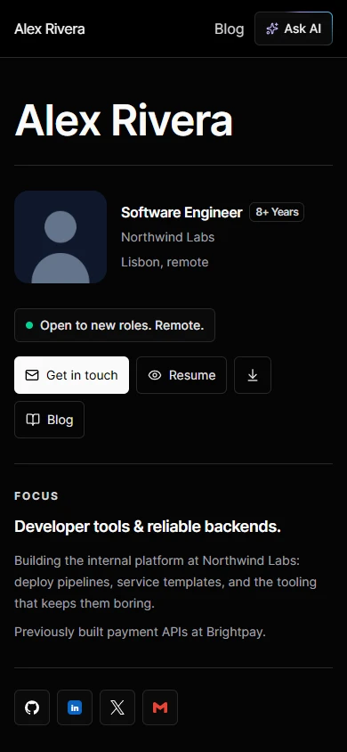

<div align="center">

# agent-ready-portfolio

**A portfolio you set up by editing files, or by asking your coding agent to do it.**<br>
SvelteKit · Tailwind · Cloudflare Pages · a blog, an MCP server and `llms.txt` built in.

[](LICENSE)




<sub>The screenshots show the placeholder content (Alex Rivera). Everything you see is replaced by your own.</sub>

[**Use this template**](../../generate) · [Setup guide](SETUP.md) · [Agent runbook](AGENTS.md) · [Deploy](DEPLOYMENT.md)

</div>

---

## Set it up with your coding agent

Open the folder in Claude Code, Codex, Cursor or any agent that reads `AGENTS.md`, and say:

> Set this up as my portfolio. Follow AGENTS.md.

The agent interviews you (name, links, work history, skills), fills in `content/`, deletes the placeholders, and runs one command that tells it exactly what is still wrong. When it is done it hands you the few steps only you can do: push to GitHub, connect Cloudflare, point your domain.

No account, API key or CMS is involved. Your site is a folder of Markdown and typed data files.

## "Done" is a command, not a feeling

`pnpm check-content` is the checklist. On a fresh template it lists every placeholder that is still there, with the file and the field:

```text
$ pnpm check-content
check-content: 19 problems

- content/site.ts: site.url is still the starter value "https://alex-rivera.example". Replace it with your own.
- content/site.ts: site.name is still the starter value "Alex Rivera". Replace it with your own.
- content/profile.ts: profile.email is still the starter value "alex@alex-rivera.example". Replace it with your own.
- content/experience.ts: still holds the example entries. Replace them with your own, or empty the list if you have none.
- content/public/resume.pdf: is still the placeholder file. Replace it with your own, or pass --allow-placeholders if you do not have one yet.
...
```

When the list is empty it prints `check-content: ok`. It also catches broken links, missing images, a post that points at a project that does not exist, and an accent colour that is not a colour. `--json` gives the same output as data for scripts. Every message says what to fix.

## What you get

<table>
<tr>
<td width="50%"></td>
<td width="50%"></td>
</tr>
<tr>
<td><sub>Posts in Markdown: table of contents, syntax highlighting, callouts, animated figures, "read with" buttons.</sub></td>
<td><sub>A blog index with tag and project filters, feeds and a social image for every post.</sub></td>
</tr>
</table>

- **Content as files.** Prose in Markdown, structured data (experience, skills, projects) as typed TypeScript with a comment above every field.
- **Blog.** Markdown posts, tags, RSS and JSON feeds, reading progress, generated Open Graph images, redirects for renamed posts.
- **Written for AI readers too.** `/llms.txt`, `/llms-full.txt`, a `.md` version of every post, and a read-only **MCP server** at `/mcp` so an agent can search and read your portfolio.
- **Ask AI.** Buttons that open Claude or ChatGPT with a prefilled question about you.
- **Static by default.** Pages are prerendered at build time. Analytics are optional and cookie-free (Cloudflare Web Analytics).
- **Switches, not forks.** Every feature is a flag in `content/site.ts`, plus an `accent` colour.
- **Safe to automate.** `pnpm verify` runs type checks, tests, the content check and a production build.

<div align="center">


<sub>Responsive down to 320px.</sub>
</div>

## Quick start

You need Node 24 and pnpm.

```sh
pnpm install
pnpm dev                # http://localhost:5173
pnpm check-content      # what is still a placeholder
pnpm new:post "My first post" --description "One sentence." --tags notes --publish
pnpm verify             # type checks, tests, content check, build
```

By hand or with an agent, the loop is the same: edit `content/`, run `pnpm check-content`, repeat until it says `ok`. Details in [SETUP.md](SETUP.md).

## Where things live

| Path | What |
| --- | --- |
| `content/site.ts` | URL, title, descriptions, `accent` colour, feature flags, analytics token |
| `content/profile.ts` | Your name, role, bio, links, email |
| `content/experience.ts`, `skills.ts` | Work history and skills |
| `content/selected-work.ts`, `github-projects.ts` | The cards on the home page; projects can have their own page in `content/projects/` |
| `content/posts/*.md` | Blog posts (`hello-world.md` is the authoring guide) |
| `content/public/` | Photo, social image, resume, icons |
| `src/` | The site itself. You should not need to edit it |
| `scripts/` | `check-content`, `new:post`, `new:project` |

## Feature flags

In `content/site.ts`:

| Flag | Turns on |
| --- | --- |
| `blog` | `/blog`, post pages, feeds, tags, the home-page section |
| `askAi` | The "Ask AI" button and dialog |
| `mcp` | The read-only MCP server at `/mcp` (needs a host that runs functions, which Cloudflare Pages does) |
| `openToWork` | A soft availability line in the hero |

`accent` sets the highlight colour (active filters, reading progress, focus rings). It takes a 6-digit hex.

## Deploy

Push to GitHub, connect the repo in Cloudflare Pages, and use `pnpm verify` as the build command. Step by step, plus the direct-upload path, in [DEPLOYMENT.md](DEPLOYMENT.md).

## FAQ

**Do I need to use an agent?** No. Every step works by hand; the agent just removes the typing.

**Why no CMS?** Your content is a few Markdown and TypeScript files in git, which an agent or an editor can change and `check-content` can verify. A CMS would add an account, a service and a second source of truth.

**Can I change the design?** The code in `src/` is yours once you copy the template. The `accent` colour is the supported knob; anything beyond that is ordinary SvelteKit work.

**Not on Cloudflare?** The adapter is `adapter-cloudflare`. Swapping it for another SvelteKit adapter works, except the `/mcp` endpoint, which needs a host that runs functions.

## Licence

MIT for the code, see [LICENSE](LICENSE). The posts, photos, resume and images of the original site this template was made from are not licensed for reuse, and are not in this repository.
